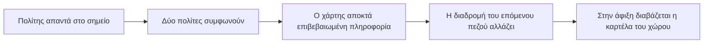
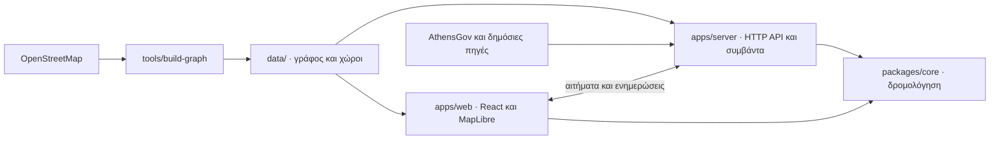

# ION Athens

Το ION Athens προτείνει διαδρομές σε κάθε πολίτη της Αθήνας ανάλογα με το πώς θέλει να μετακινηθεί σήμερα: με φωνή, με ρόδες ή με ησυχία. Οι πολίτες συμπληρώνουν τον χάρτη απαντώντας σε σύντομες ερωτήσεις επιτόπου και κερδίζουν πόντους για προνόμια που ήδη εμφανίζει η δοκιμαστική Κάρτα Αθηναίου. Σχεδιάσαμε τη λύση και για άτομα με αναπηρία, παίρνοντας ως απαιτητική δοκιμή το αν ένα τυφλό άτομο μπορεί να πληροφορηθεί εγκαίρως πού να στρίψει.

**Παρουσίαση:** [Πέντε διαφάνειες (PDF)](docs/deck/ion-athens-deck.pdf) · [Παρουσίαση εκτός σύνδεσης (HTML)](docs/deck/index.html). Στο HTML χρησιμοποιήστε τα βέλη, Home/End, F για πλήρη οθόνη και B για μαύρη οθόνη.

**Για μια πρώτη ματιά:** [οθόνες της επίδειξης](docs/mockups.md) · [τέσσερα παραδείγματα του API](docs/sample-data.md) · [άδειες και πηγές](NOTICE.md).

## Εκκίνηση σε τρεις εντολές

Χρειάζεστε **Node.js 22** και npm. Από τη ρίζα του repository, εγκαταστήστε τις εξαρτήσεις και ξεκινήστε τον server. Η δεύτερη εντολή παραμένει ενεργή.

```sh
npm ci
npm run server
```

Σε δεύτερο τερματικό, από την ίδια ρίζα:

```sh
npm run dev -w @ion/web
```

Ανοίξτε το [τηλέφωνο](http://localhost:5173/phone) ή τη [σκηνή](http://localhost:5173/stage). Το Vite προωθεί τα αιτήματα API στον server της θύρας 8787. Ο γράφος και οι ελληνικές γραμματοσειρές σερβίρονται τοπικά.

**Χωρίς κλειδί** μπορείτε να επιλέξετε προφίλ, να συγκρίνετε διαδρομές, να βρείτε χώρους του τοπικού καταλόγου, να απαντήσετε σε ερωτήσεις του χάρτη και να αποθηκεύσετε εσωτερικές διαδρομές στη μνήμη του server. Οι αναφορές και τα έργα του sandbox δεν ανανεώνονται. Λείπουν επίσης ο βοηθός προορισμών του sandbox, τα δικά του σημεία ενδιαφέροντος, η υποβολή ή επιβεβαίωση δημοτικών αναφορών και ο κατάλογος προνομίων. Το API δηλώνει την κατάσταση σύνδεσης στο [health](http://localhost:8787/api/health). Οι ανεξάρτητες δημόσιες πηγές έχουν δική τους διαθεσιμότητα.

**Με κλειδί** αντιγράψτε το [.env.example](.env.example) σε αρχείο `.env` στη ρίζα, συμπληρώστε το `SANDBOX_KEY` του hackathon και ξεκινήστε ξανά τον server. Για ολόκληρη την επίδειξη, εκτελέστε σε τρίτο τερματικό, με φρέσκια μνήμη server και ανοιχτές αποστολές:

```sh
scripts/demo-loop http://localhost:8787
```

Σε δοκιμή με το δημόσιο δείγμα, το αίτημα «Θέλω να πάω στο θέατρο» βρήκε το Ολύμπια. Δύο συμμετέχοντες επιβεβαίωσαν το ηχητικό φανάρι και ο χαρτογράφος συγκέντρωσε **70 πόντους με τρεις απαντήσεις**. Ξεκλείδωσε δοκιμαστική έκπτωση 25% στο θέατρο «Αυλαία». Η διαδρομή από την Αρσάκη ήταν 445 μ.· η παράκαμψη για τον πεζό που είχε ήδη περπατήσει το 40% έφερε το σύνολο στα 460 μ. Στην άφιξη το API επέστρεψε «10 μέτρα ευθεία (14 βήματα)». Οι αποστάσεις αλλάζουν με τα δεδομένα. Το script μετρά κάθε βήμα, επιστρέφει σφάλμα αν αποτύχει έλεγχος και κλείνει τη δική του δοκιμαστική αναφορά. Οι ψήφοι και η περιγραφή της επίδειξης μένουν στη μνήμη της συγκεκριμένης διεργασίας.

## Τι μπορείτε να δοκιμάσετε

| Λειτουργία | Πώς το βλέπετε | Κατάσταση |
|---|---|---|
| Τρεις τρόποι μετακίνησης ανάμεσα στα ίδια δύο σημεία | Στο `/stage` πατήστε **C**. Επιλέξτε μια ετικέτα και συγκρίνετε μέτρα και πορεία. **Esc** για επιστροφή. | Ζωντανός υπολογισμός σε πραγματικό δίκτυο OSM |
| Επιλογή προφίλ πριν από τον προορισμό | Στο `/phone` επιλέξτε «Με ρόδες» για να εμφανιστεί το «Πού θέλετε να πάτε;». | Διαδραστική οθόνη· η κίνηση του πεζού στο σενάριο είναι προσομοίωση |
| Ερωτήσεις στη γειτονιά | Στο `/missions` επιτρέψτε τη θέση ή ενεργοποιήστε τη θέση επίδειξης. Δύο ίδιες απαντήσεις από διαφορετικούς συμμετέχοντες επιβεβαιώνουν μια παρατήρηση. | Πραγματικά κενά στο OSM· οι απαντήσεις του demo είναι σκηνοθετημένες |
| Αναφορά εμποδίου, παράκαμψη και ανταμοιβή | Εκτελέστε το `scripts/demo-loop` όπως παραπάνω. Δείτε χωριστά το νέο μήκος από την αρχή και το μήκος για τον πεζό που βρίσκεται ήδη καθ’ οδόν. | Πραγματικός αλγόριθμος· δοκιμαστική αναφορά και προνόμια AthensGov Sandbox |
| Πληροφορίες κατά την άφιξη | Δείτε το πεδίο `arrival.speech` της διαδρομής προς το Σεράφειο ή το αποτέλεσμα του demo με επιβεβαιωμένη περιγραφή προς το ταμείο. | Καρτέλα OSM, πηγή ανά πληροφορία· η περιγραφή προς το ταμείο είναι δείγμα |



## Από πού προκύπτει η διαδρομή

Ο γράφος καλύπτει **369 χλμ.** δικτύου από το Σεράφειο έως το κέντρο, με 7.101 κόμβους, 10.360 τμήματα και 376 σημεία ενδιαφέροντος. Η μηχανή υπολογίζει διαφορετικό κόστος για το ίδιο τμήμα ανά προφίλ. Για παράδειγμα, οι ρόδες αποκλείουν τα σκαλιά, ενώ το ήσυχο προφίλ αυξάνει το κόστος σε σημείο με πρόσφατα επιβεβαιωμένο συνωστισμό. Η [αναφορά του γράφου](data/graph-report.md) μετρά και τα κενά της χαρτογράφησης.



| Πηγή | Τι δίνει | Όροι και περιεχόμενο του repository |
|---|---|---|
| OpenStreetMap | Δρόμοι, διαβάσεις, είσοδοι, χώροι | © OpenStreetMap contributors, ODbL 1.0. Τα αρχικά πλακίδια και τα παράγωγα περιλαμβάνονται στο `data/`. |
| AthensGov Sandbox | Αναφορές, έργα, POI, βοηθός και Κάρτα Αθηναίου | Συνθετικά δεδομένα του hackathon με κλειδί· ανάκτηση μέσω API. |
| Walkable Athens, Δήμος Αθηναίων / ΕΜΠ | Απογραφή πεζοδρομίων, ραμπών και διαβάσεων | Τοπικός προαιρετικός εμπλουτισμός. Η απογραφή και τα παράγωγά της μένουν στο `data-local/` εν αναμονή άδειας διανομής. |
| Γεωπύλη Δήμου · Διαύγεια | Δημοτικές υποδομές · πράξεις που μπορεί να επηρεάζουν οδό | CC BY 3.0 GR για τα δημοτικά επίπεδα· όροι του προγράμματος για τις πράξεις. Ανάκτηση από τις πηγές. |
| ΟΑΣΑ · ΣΤΑΣΥ · data.gov.gr | Στάσεις, αφίξεις, κατάσταση και θέσεις ανελκυστήρων | Διαφέρουν οι όροι ανά υπηρεσία. Τα σύνολα τρίτων δεν διανέμονται εδώ. |
| This is Athens · Υπουργείο Υγείας · Δήμος Αθηναίων | Περιγραφές προσβάσιμων διαδρομών, σύνδεσμοι εφημεριών, ανακοινώσεις, σημεία δέντρων | Τοπικές περιγραφές ή ανάκτηση κατά τη χρήση. Η άδεια του κώδικα δεν καλύπτει το περιεχόμενό τους. |
| Open-Meteo · OpenFreeMap | Βροχή · υπόβαθρο κτιρίων | CC BY 4.0 και όροι δωρεάν API για τον καιρό· αποδόσεις OpenFreeMap / OpenMapTiles / OSM για τα κτίρια. Ανάκτηση κατά τη χρήση. |

Οι σύνδεσμοι στους όρους κάθε παρόχου και στις άδειες των γραμματοσειρών βρίσκονται στο [NOTICE.md](NOTICE.md).

## Προσβασιμότητα και όρια

Η ερώτηση «Πώς θέλετε να περπατήσετε σήμερα;» απαντάται με κείμενο και πληκτρολόγιο. Η σκηνή διαφοροποιεί τις γραμμές και με μοτίβο. Στο τηλέφωνο ο σχεδιασμός προβλέπει στόχους αφής τουλάχιστον 64 px, ορατή εστίαση και ελληνικές οδηγίες. Η αντίθεση λευκού σε μαύρο είναι 21:1 και του κίτρινου της πορείας σε μαύρο 14,37:1. Οι καταστάσεις έχουν κείμενο για αναγνώστη οθόνης και η διαδρομή δίνεται και ως λίστα βημάτων. Η εκφώνηση εξαρτάται από τις διαθέσιμες ελληνικές φωνές της συσκευής. [Προδιαγραφές σχεδιασμού](design/DESIGN.md)

Στις 21/11/2026 ελέγξαμε 29 καταστάσεις με axe-core και διορθώσαμε την αντίθεση της σκοτεινής σκηνής και τα προσβάσιμα ονόματα στον χάρτη και στο κλείσιμο. Ο επανέλεγχος ολοκληρώθηκε χωρίς αυτοματοποιημένες παραβάσεις. Δοκιμάσαμε επίσης πληκτρολόγιο, μειωμένη κίνηση και αναδίπλωση στο κινητό. Εκκρεμούν δοκιμές με πραγματικό αναγνώστη οθόνης, τυφλό άτομο και άλλους χρήστες με αναπηρία. [Αποτελέσματα, όρια και εντολές επανάληψης](docs/accessibility.md)

Η βοήθεια με κάμερα βασίζεται στην περιγραφή από άνθρωπο. Η επίδειξη προβλέπει δύο συσκευές στο ίδιο δίκτυο· δεν παρέχεται TURN relay για δίκτυα που εμποδίζουν την απευθείας σύνδεση. Μια εσωτερική διαδρομή είναι περιγραφή από πολίτη που την περπάτησε. Δεν υπάρχει εντοπισμός θέσης σε εσωτερικό χώρο ή αυτόματη αναγνώριση εμποδίων από την κάμερα. Οι ανταμοιβές είναι πλασματικά προνόμια του sandbox.

## Ιδιωτικότητα

- Ο browser δημιουργεί τυχαίο αναγνωριστικό στη συσκευή. Η συμμετοχή δεν χρειάζεται λογαριασμό.
- Στις αποστολές ο server ελέγχει την απόσταση από το σημείο. Η θέση που στάλθηκε για τον έλεγχο δεν αποθηκεύεται με την απάντηση.
- Για αίτημα βοήθειας ο server κρατά θέση σε κελί περίπου 100 μ. Οι αποστάσεις προς εθελοντές στρογγυλεύονται στα 50 μ. και τα σημάδια του βοηθού σε τέσσερα δεκαδικά ψηφία συντεταγμένων.
- Το WebRTC μεταφέρει εικόνα και ήχο απευθείας. Ο server συντονίζει τη σύνδεση χωρίς να αναμεταδίδει ή να καταγράφει βίντεο.
- Ψήφοι, πόντοι και περιγραφές χώρων μένουν στη μνήμη μέχρι επανεκκίνηση. Ένα ανοιχτό αίτημα βοήθειας λήγει σε 5 λεπτά και καθαρίζεται περίπου 10 λεπτά μετά τη λήξη ή το κλείσιμο. Οι δημοτικές αναφορές που υποβλήθηκαν στο εξωτερικό sandbox έχουν δικό τους ιστορικό.

## English summary

ION Athens lets residents choose how to walk today: with voice guidance, on wheels or along a quieter route. Two matching observations can update the map used by the next walker. The repository includes the OpenStreetMap graph and a runnable theatre scenario. Node.js 22 is sufficient for local routing; the full report-and-reward demonstration also needs an AthensGov Sandbox key. Rewards and indoor directions in the script are rehearsal fixtures. User testing with disabled participants is pending.

[MIT licence for the software](LICENSE) · [Third-party notices](NOTICE.md) · [API examples](docs/sample-data.md)
