# Οθόνες της διαδρομής και του παιχνιδιού

Στιγμιότυπα του λειτουργικού πρωτοτύπου. Τα εμπόδια, ο πεζός και η διαδρομή εσωτερικού χώρου στα παραδείγματα είναι σκηνοθετημένα.

### 1. Επιλογή στο τηλέφωνο

Ο πεζός επιλέγει «Με φωνή», «Με ρόδες» ή «Με ησυχία» πριν δώσει προορισμό.

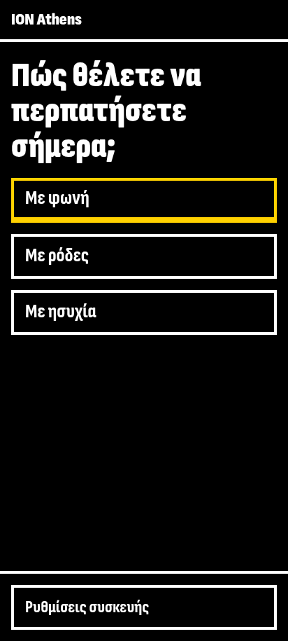

### 2. Σύγκριση στη σκηνή

Η λεζάντα και το μοτίβο γραμμής συνδέουν κάθε διαδρομή με τα δικά της χαρακτηριστικά.

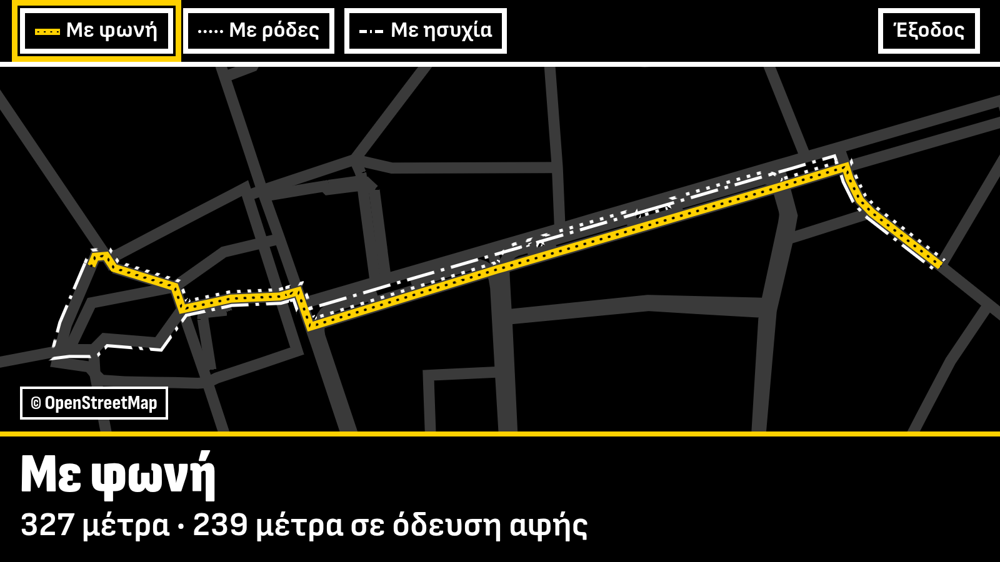

### 3. Επιβεβαιωμένο εμπόδιο

Το τηλέφωνο εμφανίζει την προειδοποίηση πριν δώσει τη νέα οδηγία.

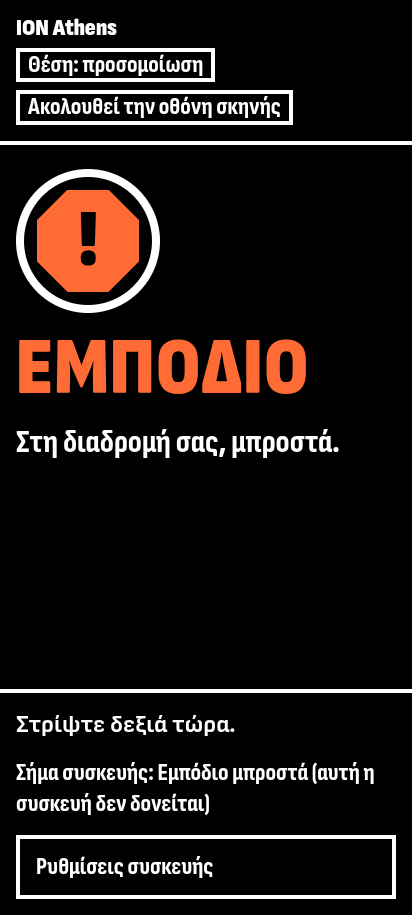

### 4. Παράκαμψη

Η σκηνή δείχνει τη νέα πορεία και μετρά πόσο πριν από τη στροφή δόθηκε η ειδοποίηση.

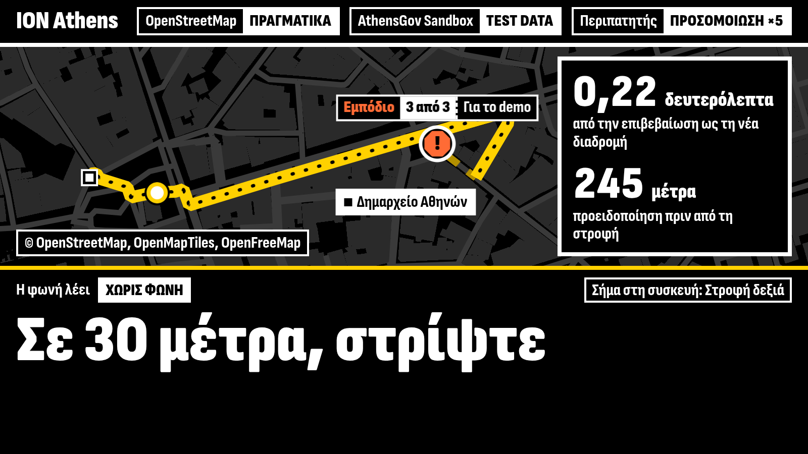

### 5. Ανθρώπινη βοήθεια

Ο εθελοντής βλέπει το αίτημα και επιλέγει αν θα απαντήσει.

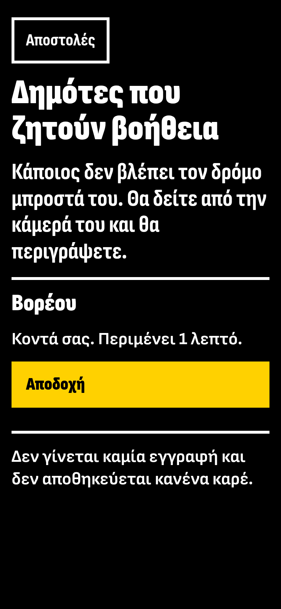

### 6. Περιγραφή εσωτερικής διαδρομής

Ο πολίτης ελέγχει την περιγραφή της πορείας που κατέγραψε προς το ταμείο.

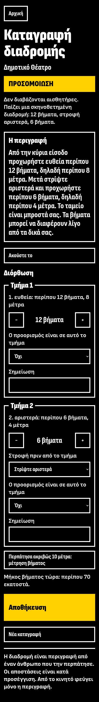

## Το παιχνίδι αποστολών

### Χάρτης αποστολών

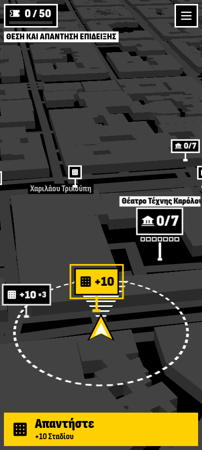

### Εντοπισμός αποστολής με την κάμερα

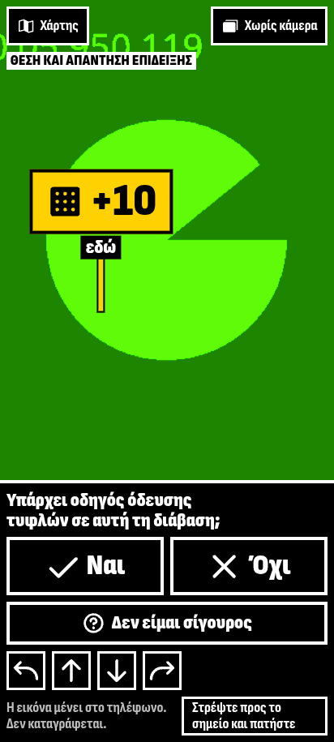

### Σφραγίδα επιβεβαιωμένης παρατήρησης

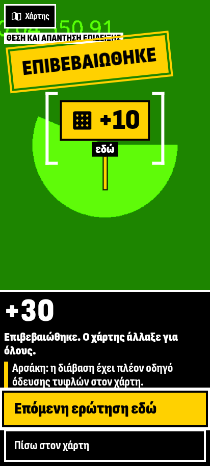

### Ανταμοιβές του δοκιμαστικού προγράμματος

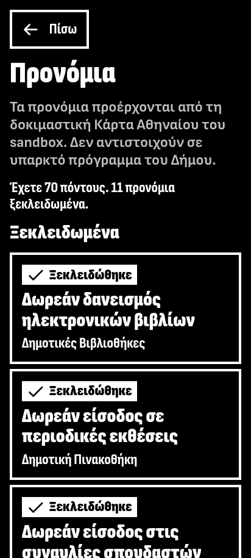

### Μενού του παιχνιδιού

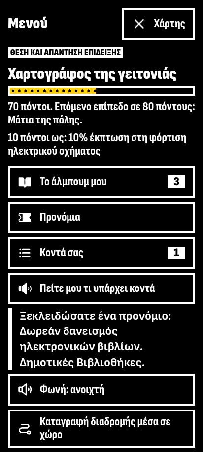

Χαρτογραφικά δεδομένα © OpenStreetMap contributors. [Άδειες και πάροχοι υποβάθρου](../NOTICE.md)
